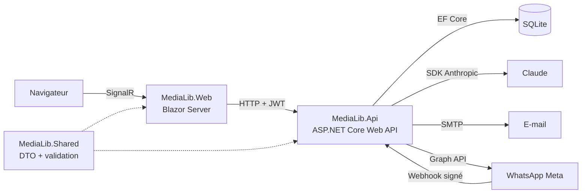

# MediaLib — Bibliothèque Vivante

Application de gestion de bibliothèque en **.NET 10** : catalogue, emprunts, réservations, comptes et rôles,
**agent bibliothécaire IA** qui répond en citant le règlement (**RAG**), **rappels automatiques** par e-mail ou **WhatsApp**,
et **validation humaine** des actions sensibles.

Mini-projet du cours ASP.NET Core / EF Core / Identity / Web API / JWT / Blazor. C'est le port fonctionnel, réécrit
entièrement en C#, d'un projet de bibliothèque initialement réalisé en Symfony.

---

## Sommaire

1. [Fonctionnalités](#fonctionnalités)
2. [Architecture](#architecture)
3. [Structure de la solution](#structure-de-la-solution)
4. [Installation et lancement](#installation-et-lancement)
5. [Comptes de test](#comptes-de-test)
6. [Configuration et secrets](#configuration-et-secrets)
7. [API REST](#api-rest)
8. [Agent IA et RAG](#agent-ia-et-rag)
9. [Communication : e-mail et WhatsApp](#communication--e-mail-et-whatsapp)
10. [Relances et décisions](#relances-et-décisions)
11. [Sécurité](#sécurité)
12. [Interface « Bibliothèque Vivante »](#interface--bibliothèque-vivante-)
13. [Tests](#tests)
14. [Correspondance Symfony → .NET](#correspondance-symfony--net)
15. [Choix techniques et limites](#choix-techniques-et-limites)

---

## Fonctionnalités

| Domaine | Ce que fait l'application |
|---|---|
| **Catalogue** | Recherche par titre, auteur ou ISBN ; filtre par catégorie et disponibilité ; tri ; pagination ; fiche détaillée. Gestion (CRUD) des livres, auteurs et catégories par les bibliothécaires. ISBN-10/13 vérifié (clé de contrôle) et unique. |
| **Emprunts** | 5 emprunts en cours au maximum, durée de 21 jours, impossible sans exemplaire disponible. Retour enregistré par un bibliothécaire, historique, suivi des retards. |
| **Réservations** | File d'attente sur un livre indisponible. Au retour, le premier de la file est prévenu et l'exemplaire lui est mis de côté pendant 3 jours. |
| **Prolongation** | Demandée par l'adhérent (7 jours, une seule fois), puis **validée par un bibliothécaire**. |
| **Comptes et rôles** | ASP.NET Core Identity : rôles **Membre**, **Bibliothécaire** et **Admin**. Mot de passe d'au moins 8 caractères avec une majuscule et un chiffre ; verrouillage après 5 échecs. |
| **Agent IA « Archimède »** | Répond aux questions, cherche les livres, donne leur disponibilité et les emprunts de l'utilisateur connecté, recommande des livres, prépare réservations, prolongations et relances, transmet la conversation à un bibliothécaire, résume la situation d'un adhérent. Fonctionne avec un **moteur simulé hors ligne** ou avec **Claude** (API Anthropic). |
| **RAG** | Documents de connaissance (règlement, conditions de prêt, FAQ, horaires, charte WhatsApp) avec statut **Brouillon / Publié / Archivé**. Découpage en fragments, classement **BM25**, réponse avec **citation** (titre, version, section). |
| **Communication** | Messages dans l'application, par **e-mail** et par **WhatsApp Business** (API Meta), avec un **transport simulé** hors ligne. Historique, statuts, idempotence, fenêtre de 24 h, STOP, repli e-mail. |
| **Relances** | Rappel 2 jours avant l'échéance, relance au lendemain du retard (automatiques), relance au 7ᵉ jour (validation humaine). Traitement planifié, réessai, aucune relance en double. |
| **Décisions** | Journal de chaque action de l'agent ou du planificateur (déclencheur, action, motif, outils, sources, statut, validateur). Validation dans l'espace bibliothécaire. |

---

## Architecture



- **Architecture en couches** dans l'API : *Controllers* (HTTP, autorisation, validation) → *Services* (règles métier) → *Data* (EF Core).
- **MediaLib.Shared** est le contrat entre le front et le back : uniquement des DTO, des enums et de la validation. Blazor n'utilise **jamais** les entités EF.
- **Blazor Web App** en rendu *Interactive Server*, sans pré-rendu : l'interface s'exécute sur le serveur, et le navigateur reçoit les mises à jour par SignalR. Le jeton JWT est stocké chiffré dans le navigateur (`ProtectedLocalStorage`).

---

## Structure de la solution

```
MediaLib/
├── MediaLib.slnx
├── dotnet-tools.json            outil local dotnet-ef 10 (migrations)
├── docs/GUIDE_SOUTENANCE.md     explication détaillée du projet (architecture, flux, questions-réponses)
├── src/
│   ├── MediaLib.Shared/         Enums.cs, Dto.cs, Validation.cs (ISBN, téléphone E.164, JSON)
│   ├── MediaLib.Api/
│   │   ├── Program.cs           configuration : EF, Identity, JWT, rate limiting, OpenAPI, injection de dépendances
│   │   ├── Domain/              entités EF (Livre, Emprunt, Reservation, Utilisateur, Conversation, Relance, DecisionAgent…)
│   │   ├── Data/                DbContext, migrations, seed
│   │   ├── Controllers/         endpoints REST
│   │   ├── Services/            règles métier (emprunts, réservations, relances, décisions, politique des actions)
│   │   ├── Auth/                JWT et refresh token
│   │   ├── Connaissance/        RAG (normalisation, découpage, BM25)
│   │   ├── Agent/               agent IA (moteur simulé, moteur Claude, outils, consigne)
│   │   ├── Communication/       e-mail, WhatsApp, transport simulé, webhook
│   │   └── Infrastructure/      gestion des erreurs (ProblemDetails), OpenAPI
│   └── MediaLib.Web/
│       ├── Services/            ApiClient, AuthenticationStateProvider personnalisé
│       ├── Components/Pages/    pages publiques, membre et espace bibliothécaire (Gestion/)
│       ├── Components/Shared/   BookCard, StatusBookmark, RagCitationTag, Archimede…
│       └── wwwroot/app.css      design system
└── tests/MediaLib.Tests/        tests unitaires, d'intégration et fonctionnels (xUnit)
```

---

## Installation et lancement

**Prérequis** : [SDK .NET 10](https://dotnet.microsoft.com/download). Aucune base de données à installer : SQLite crée le fichier `src/MediaLib.Api/medialib.db`.

```powershell
git clone https://github.com/sheimachabchoub/.net-project.git
cd .net-project
dotnet tool restore
dotnet build
```

Créer la base. C'est facultatif : les migrations et le seed sont aussi appliqués automatiquement au premier démarrage de l'API.

```powershell
dotnet ef database update -p src/MediaLib.Api -s src/MediaLib.Api
```

Lancer l'API dans un premier terminal :

```powershell
dotnet run --project src/MediaLib.Api --launch-profile http
```

Puis, quand l'API a démarré, lancer Blazor dans un second terminal :

```powershell
dotnet run --project src/MediaLib.Web --launch-profile http
```

| Adresse | Contenu |
|---|---|
| http://localhost:5038 | Application Blazor |
| http://localhost:5032/scalar/v1 | Documentation interactive de l'API (Scalar) |
| http://localhost:5032/openapi/v1.json | Document OpenAPI |

Pour repartir d'une base neuve, supprimer `src/MediaLib.Api/medialib.db`, puis relancer l'API.

---

## Comptes de test

Ce sont des données de démonstration créées par le seed (`src/MediaLib.Api/Data/Seed.cs`), pas de vrais comptes.

| Rôle | E-mail | Mot de passe |
|---|---|---|
| Membre | `membre@medialib.local` | `Membre123` |
| Bibliothécaire | `biblio@medialib.local` | `Biblio123` |
| Admin | `admin@medialib.local` | `Admin1234` |

Le seed crée aussi 10 auteurs, 5 catégories, 30 livres, 5 documents de connaissance publiés et 1 brouillon, ainsi que quelques emprunts pour le membre : un en cours, un en retard et un rendu.

**Ajouter un bibliothécaire** : la personne s'inscrit (elle reçoit le rôle Membre), puis l'Admin coche le rôle « Bibliothecaire » dans *Espace bibliothécaire → Utilisateurs et rôles*. La personne doit ensuite se reconnecter.

---

## Configuration et secrets

Toute la configuration est dans `src/MediaLib.Api/appsettings.json`.

| Section | Contenu |
|---|---|
| `Bibliotheque` | `MaxEmprunts` (5), `DureeJours` (21), `JoursAvantEcheance` (2), `ProlongationJours` (7), `ProlongationsMax` (1), `DelaiRetraitReservationJours` (3), `TentativesMax` (3), `RelanceRetardJours` (1), `RelanceValidationJours` (7) |
| `Jwt` | émetteur, audience, durée de l'access token (15 min) et du refresh token (7 j), clé de signature |
| `Agent` | `Mode` : `simule` (par défaut) ou `claude` ; `Modele`, `MessagesParMinute`, `PlafondQuotidien` |
| `Messagerie` | `Transport` : `simule` (par défaut) ou `reel` ; paramètres SMTP |
| `WhatsApp` | jeton, identifiant du numéro, secret d'application (signature du webhook), jeton de vérification |
| `Planificateur` | activation et intervalle du traitement des relances |
| `LimiteDebit` | requêtes par minute (connexion, agent) |

**Aucun vrai secret n'est dans le dépôt.** `appsettings.Development.json` contient seulement des valeurs de développement (clé JWT `DEV-ONLY-…`). Pour de vraies valeurs, utiliser les *user-secrets* en développement :

```powershell
dotnet user-secrets set "Jwt:Cle" "<clé aléatoire d'au moins 32 caractères>" --project src/MediaLib.Api
```

```powershell
dotnet user-secrets set "Agent:CleApi" "<clé API Anthropic>" --project src/MediaLib.Api
```

En production, on utilise des variables d'environnement, avec un double underscore à la place des deux-points (par exemple `Jwt__Cle`, `Agent__CleApi`, `WhatsApp__SecretApplication`).

---

## API REST

Tous les endpoints sont documentés dans Scalar, avec leurs codes de retour : **200, 201 + Location, 202, 204, 400, 401, 403, 404, 409, 429**. Les erreurs sont renvoyées au format **ProblemDetails**.

| Méthode | Route | Accès |
|---|---|---|
| POST | `/api/auth/inscription` · `/api/auth/connexion` · `/api/auth/refresh` | Anonyme |
| POST | `/api/auth/deconnexion` · GET `/api/auth/moi` | Connecté |
| GET | `/api/livres?q=&categorieId=&tri=&page=&taillePage=&disponibles=` · `/api/livres/{id}` | Anonyme |
| GET | `/api/auteurs` · `/api/categories` (et `/{id}`) | Anonyme |
| POST / PUT / DELETE | `/api/livres` · `/api/auteurs` · `/api/categories` (409 si un auteur ou une catégorie est lié à un livre) | Bibliothécaire, Admin |
| POST | `/api/emprunts` | Membre (ou bibliothécaire pour un adhérent) |
| GET | `/api/emprunts/moi` · `/api/emprunts/moi/historique` · `/api/emprunts/{id}` | Connecté (ses propres emprunts) |
| POST | `/api/emprunts/{id}/prolongation` | Membre |
| POST | `/api/emprunts/{id}/retour` · GET `/api/emprunts?enRetard=true` | Bibliothécaire, Admin |
| POST · GET · DELETE | `/api/reservations` · `/api/reservations/moi` · `/api/reservations/{id}` | Membre |
| POST | `/api/agent/messages` | Anonyme ou connecté |
| GET | `/api/agent/conversations` (et `/{id}`) · POST `/api/agent/propositions/{id}/confirmer` | Connecté |
| GET | `/api/documents/recherche?q=` | Anonyme (documents publiés uniquement) |
| GET / POST / PUT / DELETE | `/api/documents` (+ `/{id}/publier`, `/{id}/archiver`) | Bibliothécaire, Admin |
| GET / POST | `/api/gestion/conversations` (+ `/{id}/reprendre`, `/rendre-agent`, `/cloturer`, `/messages`) | Bibliothécaire, Admin |
| GET / POST | `/api/decisions` (+ `/{id}/approuver`, `/{id}/rejeter`) | Bibliothécaire, Admin |
| GET / POST | `/api/relances` · `/api/relances/traitement` | Bibliothécaire, Admin |
| GET / PUT / POST | `/api/admin/utilisateurs` (+ `/{id}/roles`, `/{id}/deverrouiller`) | Admin |
| PUT / POST / DELETE | `/api/compte/profil` · `/api/compte/whatsapp/consentement` · `/api/compte/whatsapp/liaison` | Connecté |
| GET / POST | `/api/webhooks/whatsapp` | Meta (signature vérifiée) |
| GET | `/api/regles` · `/api/regles/politique` | Anonyme |

---

## Agent IA et RAG

**Ce qui se passe quand on pose une question**, par exemple « Combien de temps puis-je garder un livre ? » :

1. La page Blazor envoie `POST /api/agent/messages`. L'API lit l'identité dans le **jeton JWT**, jamais dans le texte de la question.
2. La **limite de débit** et le **plafond quotidien** d'appels au modèle sont vérifiés.
3. Le moteur est choisi : **simulé** (règles et mots-clés, hors ligne) ou **Claude** (SDK officiel Anthropic, avec appel d'outils). Si Claude est indisponible, refuse de répondre, n'a pas de clé ou a atteint son plafond, on **revient automatiquement** au moteur simulé.
4. Le moteur appelle l'outil `chercherReglement`, qui interroge le **RAG** :
   - seuls les documents **publiés** sont indexés ; ils sont découpés en fragments, un par section Markdown ;
   - le texte est **normalisé** : minuscules, accents retirés, mots vides retirés, racinisation légère, synonymes du domaine ;
   - les fragments sont classés avec **BM25** (TF × IDF, normalisé par la longueur), et les 3 meilleurs sont gardés ;
   - **brouillons et archives sont exclus** ; publier une nouvelle version archive l'ancienne.
5. La réponse **cite sa source** (« Conditions de prêt — Version 1.0 — Section : Durée et nombre de livres ») et la décision est **journalisée** (outils consultés, sources, moteur).
6. Blazor affiche la réponse avec une **fiche de source cliquable**, qui ouvre le passage exact.

**Outils de l'agent** : `rechercherLivres`, `voirDisponibilite`, `recommanderLivres`, `chercherReglement`, `voirMesEmprunts`, `preparerReservation`, `preparerProlongation`, `preparerRelance`, `transmettreAuBibliothecaire`, `resumerAdherent`. **Aucun outil n'accepte d'identifiant d'utilisateur** : l'agent ne peut donc consulter que les données de la personne connectée.

**Politique des actions** :

| Classement | Actions |
|---|---|
| Automatique | rappel J-2, relance J+1, réponse dans la conversation, notification de réservation, escalade |
| Validation requise | relance J+7, prolongation, message libre de l'agent |
| Interdite | enregistrer un emprunt ou un retour, modifier le catalogue, supprimer des données, **toute action inconnue** |

**Escalade vers un humain** : en cas de contestation, de demande explicite ou de clic sur « Parler à un bibliothécaire », la conversation passe à l'état *Humain*. L'agent se tait alors, et le bibliothécaire reprend la main depuis l'espace bibliothécaire.

---

## Communication : e-mail et WhatsApp

- **Choix du canal** : WhatsApp seulement si le numéro est valide (format E.164), **lié** par un code à 6 chiffres envoyé depuis WhatsApp, **et** que l'adhérent a donné son consentement. Sinon, e-mail.
- **Webhook Meta** : vérification de l'abonnement (`hub.verify_token`) et de la **signature HMAC-SHA256** (`X-Hub-Signature-256`). Les événements rejoués par Meta sont ignorés (idempotence).
- **STOP** retire immédiatement le consentement. **OUI** confirme une réservation proposée par l'agent.
- **Fenêtre de 24 h** : un message libre n'est possible que dans les 24 h suivant le dernier message de l'adhérent ; en dehors, seuls les modèles approuvés (rappels) partent.
- **Statuts Meta** (envoyé, distribué, lu, échec) suivis sans retour en arrière. Un échec de livraison d'une relance déclenche une escalade.
- **Repli e-mail** si l'envoi WhatsApp échoue.
- **Transport simulé** par défaut : aucun envoi réel, tout est journalisé.

---

## Relances et décisions

- Un **BackgroundService** (`PlanificateurRelances`) exécute le traitement toutes les heures. On peut aussi le lancer depuis l'espace bibliothécaire.
- **Détection** : échéance dans 2 jours (rappel), retard d'au moins 1 jour (relance), retard d'au moins 7 jours (relance avec validation).
- **Idempotence** : une clé unique par emprunt, niveau et échéance, protégée par un index unique en base. Il n'y a jamais de doublon.
- **Réessai** jusqu'à `TentativesMax`, puis escalade vers un bibliothécaire. Une relance est **annulée** si le livre est rendu ou si l'échéance a été prolongée.
- **Journal des décisions** : déclencheur, action proposée et retenue, motif, outils, sources, données, statut, résultat, validateur, dates.

---

## Sécurité

- **JWT** : access token de 15 min. Émetteur, audience, signature HMAC-SHA256 et expiration sont validés.
- **Refresh token** : aléatoire, **stocké haché** (SHA-256) et **tournant**. Réutiliser un ancien jeton révoque toute la session. Les jetons sont aussi révoqués à la déconnexion et quand les rôles changent.
- **Identity** : politique de mot de passe et **verrouillage après 5 échecs**.
- **Limitation de débit** (429) sur la connexion, l'inscription et l'agent.
- **Autorisation par rôles** dans l'API (la vraie barrière) et dans Blazor (`[Authorize]`, `AuthorizeView`, redirection vers la connexion avec la page demandée).
- **Données personnelles** : un membre ne voit que ses emprunts. L'emprunt d'un autre renvoie 404, pour ne même pas révéler qu'il existe.
- **Concurrence** : jeton de concurrence optimiste sur `Livre` et contrainte `CHECK NbDisponibles >= 0`. Le dernier exemplaire ne peut être emprunté qu'une fois.
- **Agent IA** : identité côté serveur, politique des actions (refus par défaut), validation humaine, traçabilité.

---

## Interface « Bibliothèque Vivante »

- **Palette** : crème `#F5EBDD`, parchemin `#E8D7BA`, vert olive `#788363`, vert foncé `#24352D`, brun bois `#4A3428`, terracotta `#A7614C`, doré ancien `#C39A5A`.
- **Typographie** : Cormorant Garamond pour les titres, Inter pour les textes et les données.
- **Mise en page** : barre supérieure avec navigation, menu repliable sur mobile ; accueil illustré (coin lecture dessiné en SVG) ; catalogue en étagère ; détail présenté comme un livre ouvert ; espace bibliothécaire plus sobre.
- **Marque-pages de statut** : vert pour un emprunt en cours, jaune pour une échéance proche, rouge pour un retard, bleu pour une réservation.
- **Un seul personnage** : Archimède, le hibou bibliothécaire, avec sa lampe qui s'allume quand il cherche. Il apparaît sur la page Assistant, comme avatar des réponses et dans l'illustration d'accueil.
- **Sources RAG** affichées en fiches cliquables.
- Les animations sont discrètes et désactivées si l'utilisateur préfère réduire les animations.

---

## Tests

```powershell
dotnet test
```

97 tests **xUnit**. Les tests d'intégration démarrent l'API complète en mémoire (`WebApplicationFactory`, SQLite en mémoire, horloge réglable, transport simulé).

| Type | Ce qui est couvert |
|---|---|
| Unitaires | ISBN, politique des actions, statuts d'emprunt, fenêtre de 24 h, signature du webhook, découpage et normalisation RAG, limiteur de l'agent |
| Intégration | inscription et connexion, JWT invalide ou expiré, refresh token, verrouillage, rôles, rate limiting, CRUD, recherche, pagination, 409, max 5 emprunts, 21 jours, disponibilité, retours, retards, réservations, prolongation, concurrence, RAG, agent (moteur simulé), relances, idempotence, repli e-mail, webhook WhatsApp, signature invalide, fenêtre de 24 h, validation des décisions |
| Fonctionnels | parcours complets : inscription → recherche → emprunt → retour → historique ; gestion du catalogue et des rôles |

---

## Correspondance Symfony → .NET

| Symfony | .NET (MediaLib) |
|---|---|
| Entités Doctrine (`Livre`, `Auteur`, `Category`, `Emprunt`, `Reservation`…) | `Api/Domain/` + `MediaLibDbContext` |
| `User` + `security.yaml` | `Utilisateur : IdentityUser`, rôles Identity, JWT Bearer (`Auth/AuthService.cs`) |
| Doctrine Migrations, fixtures | EF Core Migrations (`Data/Migrations`), `Data/Seed.cs` |
| `Service/EmpruntService`, `ReservationService` | `Services/EmpruntService.cs`, `Services/ReservationService.cs` |
| `Event/LivreRendu` | interface `IObservateurRetour` |
| `Service/RelanceService` + Messenger | `Services/RelanceService.cs` + `PlanificateurRelances` (BackgroundService) |
| `Service/PolitiqueActions`, `JournalDecisions`, `ValidationDecisions`, `DemandesAdherent` | `Services/Fondations.cs`, `Services/Decisions.cs` |
| `Communication/*` | `Communication/ServiceCommunication.cs`, `Expediteurs.cs` |
| `Webhook/MetaWhatsappRequestParser`, `TraitementMessageEntrant` | `Communication/WebhookWhatsApp.cs` |
| `Service/LiaisonWhatsapp` | `Communication/LiaisonWhatsApp.cs` |
| `Connaissance/*` (BM25) | `Connaissance/Rag.cs` |
| `Agent/BibliothecaireIA`, `MoteurSimule`, `MoteurLlm`, `Outil/*` | `Agent/BibliothecaireIA.cs`, `MoteurSimule.cs`, `MoteurClaude.cs`, `Outils.cs` |
| `rate_limiter.yaml` | `AddRateLimiter` + `LimiteurAgent` |
| Twig + EasyAdmin | Blazor (`MediaLib.Web`) |

---

## Choix techniques et limites

**Choix**
- **SQLite** : aucune installation, et la même base sert aux tests (en mémoire). Passer à SQL Server demande seulement de remplacer `UseSqlite` par `UseSqlServer` et de générer une nouvelle migration.
- **RAG lexical (BM25)** plutôt que des embeddings : le corpus est petit, l'approche fonctionne hors ligne, ne coûte rien et donne des résultats explicables. On pourrait évoluer vers une recherche hybride (BM25 + vecteurs) sans changer l'interface de recherche.
- **Blazor Server** : le C# est partagé entre front et back, et l'API est appelée de serveur à serveur.
- **`TimeProvider`** injecté : toutes les règles qui dépendent du temps sont testables.

**Limites connues**
- La réponse de l'IA arrive en une fois (pas de streaming).
- SQLite et le limiteur en mémoire supposent une seule instance du serveur.
- Les envois réels (SMTP, WhatsApp, Claude) n'ont pas été testés avec de vrais identifiants : les tests utilisent le transport et le moteur simulés.

Pour une explication détaillée (flux complets, rôle de chaque fichier, questions-réponses), voir [docs/GUIDE_SOUTENANCE.md](docs/GUIDE_SOUTENANCE.md).
